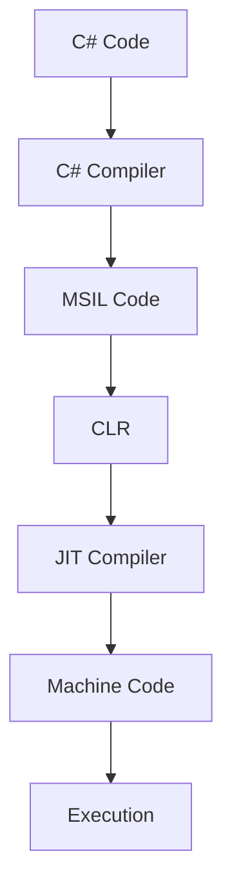

# Class Notes

## Lecture 10 : Points to remember

### .NET Framework 

Execution flow:

- **C# Code**: The source code written by the programmer.
- **MSIL (Microsoft Intermediate Language)**: The intermediate code generated by the C# compiler.
- **CLR (Common Language Runtime)**: The runtime environment responsible for executing managed code.
- **JIT (Just-In-Time) Compiler**: Converts MSIL into native machine code at runtime.
- **Native Machine Code**: Machine instructions that the processor can execute directly.

>**Note**: The operating system and CPU ultimately execute native machine code, not C# source code or MSIL directly.

---

### Advantages of CLR as an Intermediate Runtime

1. **Garbage Collection**: Automatically manages memory and releases memory occupied by objects that are no longer needed.
2. **Code Optimization**: JIT compiler optimizes code for execution.
3. **Security** : Provides runtime checks, type safety, and security-related services.
4. **Portability**: MSIL can run on different platforms that support a compatible .NET runtime.
5. **Exception Handling**: Provides a common mechanism for handling runtime errors.
6. **Language Interoperability**: Allows code written in different .NET languages, such as C# and VB.NET, to interact.

 

---

### Home Work

- Read about anthropic version controller scion (https://www.anthropic.com/research/redesigning-source-control)

- Create a function app with an http trigger to square a number in azure . Write a client side app using Rest API. such that the cloud return the answer.

 

---

